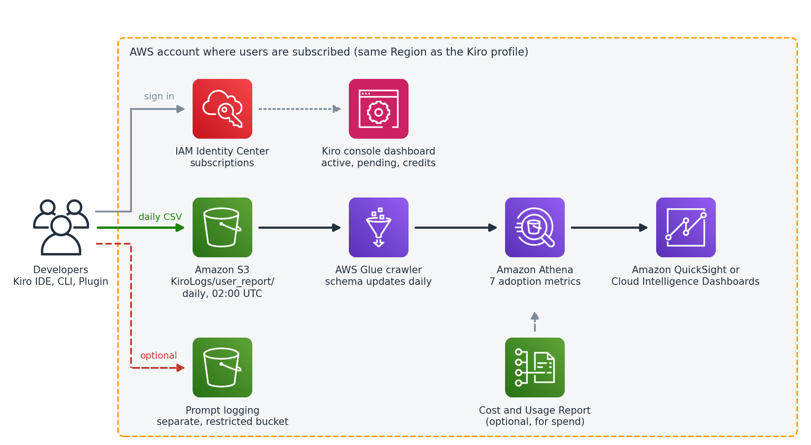

# kiro-adoption-metrics

Measure how your team uses Kiro, not just how much it spends. This repo turns Kiro's daily per-user activity report into Athena tables and five saved queries: active rate, depth, turns per conversation, model mix, and burn rate.

Companion to the blog post: [YOUR POST LINK]



## What it deploys

Everything runs in the AWS account and Region where your Kiro users are subscribed.

- **Report bucket** for Kiro's daily CSVs: Block Public Access, ACLs disabled, versioning, SSE-S3, TLS-only, and the Kiro write policy. Retained on delete, because it holds your history.
- **Athena results bucket**, with results expiring after 30 days.
- **Glue database and crawler**, scheduled at 03:30 UTC (after Kiro's 02:00 UTC report). It merges new model columns as they appear and keeps the IDE, CLI, and Plugin files in one table.
- **Athena workgroup with five saved queries** (also in [`queries/`](queries/)).

## Deploy

### CloudFormation (tested)

```bash
aws sts get-caller-identity   # confirm the account first
aws cloudformation deploy \
  --template-file cloudformation/kiro-adoption-metrics.yaml \
  --stack-name kiro-adoption-metrics \
  --capabilities CAPABILITY_IAM \
  --region <your Kiro profile Region>

aws cloudformation describe-stacks --stack-name kiro-adoption-metrics \
  --query "Stacks[0].Outputs[?OutputKey=='KiroReportS3Uri'].OutputValue" --output text
```

### Terraform

```bash
cd terraform
terraform init
terraform plan -var region=<your Kiro profile Region>
terraform apply -var region=<your Kiro profile Region>
terraform output -raw kiro_report_s3_uri
```

The Terraform version mirrors the CloudFormation template resource for resource. The CloudFormation version is the one deployed and tested end to end; run `terraform plan` and read it before applying.

## Turn on the report

1. **Kiro console > Access management:** make sure at least one user shows **Seated**. A report with no seated users is an empty report.
2. **Kiro console > Settings > Usage activity > Kiro user activity report > Manage:** choose **CSV report per Kiro client type**, paste the S3 URI output, and choose **Enable**.

The report is written **once a day at 02:00 UTC**. It doesn't stream, and the schedule isn't configurable. Each row covers one user for one UTC day.

## Run the queries

After the first file lands, start the crawler (or wait for 03:30 UTC), then open Athena, switch to the stack's workgroup, and run the saved queries in order:

| Query | What it answers |
|---|---|
| `0-check-rows-per-day` | Is data landing every day? |
| `1-list-model-columns` | Which `<model>_messages` columns exist today? Paste them into query 3. |
| `2-active-users-depth-turns-per-conversation-7-days` | How many people use Kiro, how unevenly, and are they having real conversations or one-shot questions? |
| `3-model-mix-30-days-edit-the-arrays-first` | What share of messages goes to Auto vs. pinned frontier models? |
| `4-burn-rate-and-tier-fit-month-to-date` | Who will hit their credit cap early, and who is on too big a plan? |

## Gotchas

- **The schema changes daily.** A `<model>_messages` column appears only on days someone used that model. The crawler merges new columns; older days return null for newer models.
- **`date` is a reserved word in Athena.** Quote it as `"date"`.
- **The crawler lowercases column names.** `Total_Messages` becomes `total_messages`.
- **The report includes `User_Email`.** Restrict who can read the bucket.
- **Cross-account buckets aren't supported.** Deploy one stack per account where users are subscribed.

## Cost

A few cents a month for S3, Glue crawler runs, and Athena scans at small-team scale. Check current pricing for your Region.

## License

MIT-0
